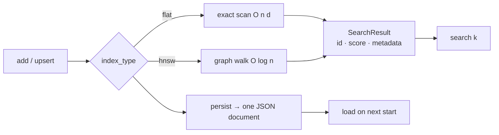

<p align="center">
  <em>Store embeddings, search them with an HNSW graph, persist to one JSON file. No server, no native build, no dependencies.</em>
</p>

<p align="center">
  
  
  
</p>

---

A vector database that is a library, not a service. Fixed-dimension vectors, an
exact brute-force index or an approximate HNSW graph, and every collection
serialised as a single self-describing JSON document.

## Quick start

```python
from lumen import Lumen

db = Lumen("./.lumen")
docs = db.create_collection("docs", dim=4)          # HNSW by default

docs.add("a", [1, 0, 0, 0], metadata={"title": "alpha"})
docs.add("b", [0, 1, 0, 0])
db.persist(docs)

hits = db.get_collection("docs").search([0.9, 0.1, 0, 0], k=1)
print(hits[0].id)          # 'a'
```

```bash
python -m lumen.cli add docs --id c --vector 0.1 0.9 0 0
python -m lumen.cli search docs --vector 0 1 0 0 --k 2
```

## Two indexes, one interface

| `index_type` | Recall | Cost | Use when |
|---|---|---|---|
| `"flat"` | exact | O(n·d) per query | Under ~10k vectors, or correctness over latency |
| `"hnsw"` (default) | approximate | O(log n) after build | Larger collections where a small recall loss is fine |

Both satisfy the `VectorIndex` interface, so switching is one argument:

```python
exact = db.create_collection("small", dim=4, index_type="flat")

tuned = db.create_collection(
    "big", dim=384,
    index_type="hnsw",
    index_params={"M": 16, "ef_construction": 200, "ef": 64},
)
```

Five distance metrics: `chebyshev`, `cosine` (default), `dot`, `euclidean`,
`manhattan` — pass `metric=` to `create_collection`, or list them at runtime with
`lumen.available_metrics()`.

## How it works



The HNSW implementation is the real article: a multi-layer graph, greedy descent
from the top layer, `ef`-bounded beam search at layer 0, and bidirectional link
maintenance with neighbour pruning. It is written to be read, which is why it is
plain Python.

## API

| Call | Returns |
|---|---|
| `Lumen(root)` | A database rooted at a directory |
| `db.create_collection(name, dim, metric="cosine", index_type="hnsw", index_params=None)` | `VectorCollection` |
| `db.get_collection(name)` | `VectorCollection` |
| `collection.add(id, vector, metadata=None)` | Insert or overwrite by id |
| `collection.search(vector, k=10)` | `list[SearchResult]`, sorted by score |
| `collection.stats()` | `CollectionStats(name, dim, metric, index_type, count)` — note this is a method here, unlike some sibling libraries |
| `db.persist(collection)` | Write the collection to one JSON file |

## Tests

```bash
python -m pytest -q
```

## Limitations

- **Pure Python.** The HNSW walk runs at Python speed, so it is slow next to
  hnswlib or FAISS. The point is that you can read and change it.
- **Single process.** No concurrency control — two writers on the same directory
  corrupt the JSON. This is not a multi-tenant service.
- **Whole-collection serialisation.** `persist` rewrites the entire document. Fine
  to a few hundred thousand vectors, wrong beyond that.
- **No filter expressions.** Metadata is stored and returned, never queried on;
  pre-filter in Python before searching.

## License

MIT
